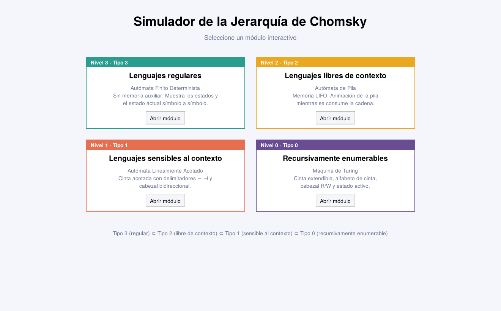
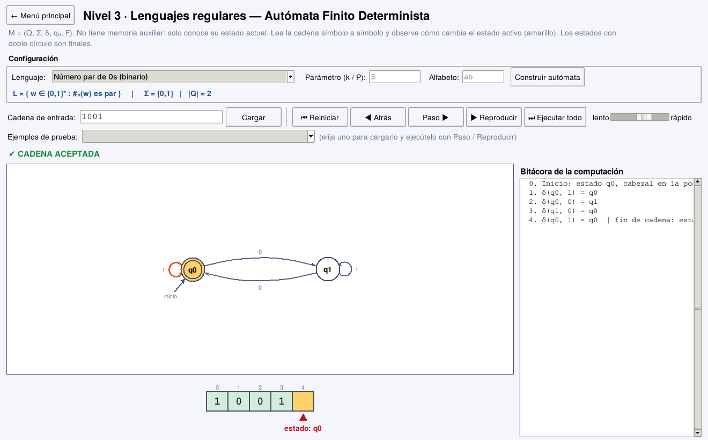
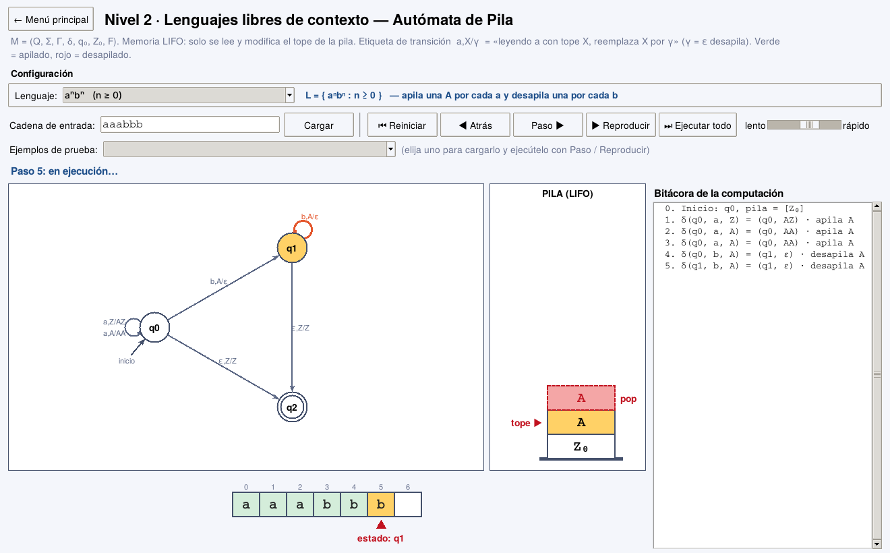
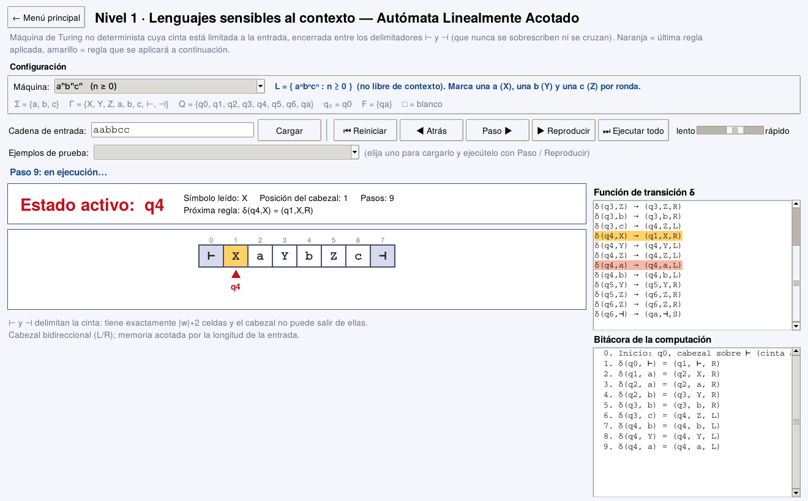
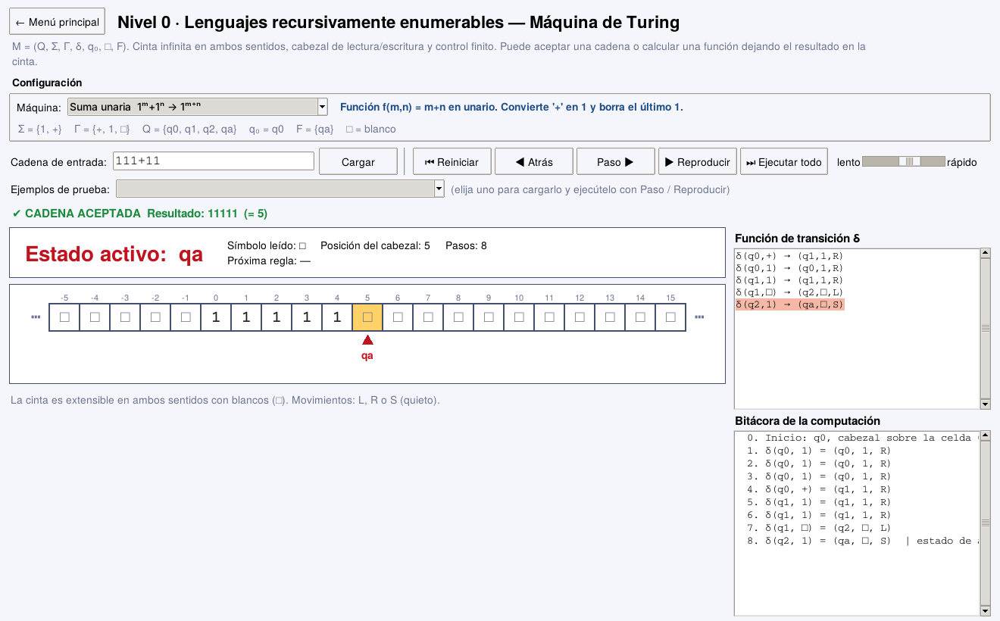

# Simulador de la Jerarquía de Chomsky

Aplicación de escritorio con interfaz gráfica (Python + Tkinter) que permite **visualizar y simular** los modelos computacionales de los cuatro niveles de la Jerarquía de Chomsky:

| Nivel | Lenguajes | Modelo | Memoria |
|-------|-----------|--------|---------|
| 3 | Regulares | Autómata Finito Determinista (AFD) | Ninguna (solo el estado) |
| 2 | Libres de contexto | Autómata de Pila (AP) | Pila (LIFO) |
| 1 | Sensibles al contexto | Autómata Linealmente Acotado (LBA) | Cinta acotada a la entrada |
| 0 | Recursivamente enumerables | Máquina de Turing (MT) | Cinta infinita |



---

## 1. Requisitos

- **Python 3.8 o superior**
- **Tkinter** (viene con Python en Windows y macOS; en Linux se instala aparte)
- No hay dependencias externas: no hace falta `pip install` de nada.

## 2. Instalación

**Windows**
1. Descargue Python desde <https://www.python.org/downloads/>.
2. En el instalador marque **"Add Python to PATH"** y deje activada la opción **"tcl/tk and IDLE"**.

**macOS**
- Instale Python desde <https://www.python.org/downloads/> (incluye Tkinter).
- Con Homebrew: `brew install python-tk`.

**Linux (Debian / Ubuntu)**
```bash
sudo apt install python3 python3-tk
```

Para comprobar que Tkinter funciona: `python -m tkinter` (debe abrirse una ventana de prueba).

## 3. Ejecución

```bash
git clone https://github.com/<su-usuario>/<su-repositorio>.git
cd <su-repositorio>
python jerarquia_chomsky.py        # en Linux/macOS: python3 jerarquia_chomsky.py
```

Se abre el **panel principal** con cuatro tarjetas; elija un módulo con **"Abrir módulo"** y use **"← Menú principal"** para volver.

---

## 4. Manual de usuario

### 4.1 Controles comunes a los cuatro módulos

| Control | Función |
|---------|---------|
| **Cadena de entrada** | Escriba la cadena y pulse **Cargar** (o Enter). Para la cadena vacía deje el campo vacío o escriba `ε`. |
| **Ejemplos de prueba** | Lista desplegable con cadenas que se aceptan (✔) y que se rechazan (✘). Al elegir una se carga automáticamente. |
| **⏮ Reiniciar** | Vuelve al inicio de la computación. |
| **◀ Atrás / Paso ▶** | Retrocede o avanza una transición. |
| **▶ Reproducir** | Avanza automáticamente; la barra *lento ↔ rápido* regula la velocidad. |
| **⏭ Ejecutar todo** | Salta directamente al resultado final. |
| **Bitácora** | Lista cada transición aplicada (panel derecho). |
| **Resultado** | Aparece sobre el área gráfica: ✔ CADENA ACEPTADA / ✘ CADENA RECHAZADA. |

### 4.2 Nivel 3 · Lenguajes regulares (AFD)



- Muestra el **diagrama de estados**: el estado actual en amarillo, los estados finales con doble círculo y la última transición en rojo.
- La **cinta de entrada** marca en verde los símbolos ya leídos y el cabezal indica el símbolo siguiente.
- Lenguajes disponibles:
  - Número par de 0s (binario)
  - Termina en `ab` (Σ = {a,b})
  - Binarios divisibles por **k** → *parametrizable*: escriba k (2 a 10) en "Parámetro" y pulse **Construir autómata**
  - Contiene la subcadena **P** → *parametrizable*: escriba P y el alfabeto, y pulse **Construir autómata**

**Cadenas de prueba** (la lista desplegable de este módulo se genera automáticamente según el lenguaje y sus parámetros, por lo que puede incluir otras cadenas; las de esta tabla también son válidas):

| Lenguaje | Se aceptan ✔ | Se rechazan ✘ |
|----------|--------------|----------------|
| Par de 0s | `ε`, `11`, `1001`, `0110` | `0`, `10`, `1011`, `000` |
| Termina en `ab` | `ab`, `aab`, `bbab`, `abab` | `ε`, `a`, `ba`, `abb` |
| Divisible por 3 (k=3) | `ε`, `0`, `11`, `110`, `1001` | `1`, `10`, `100`, `101` |
| Contiene `aba` (Σ={a,b}) | `aba`, `aaba`, `babab`, `abaa` | `ε`, `ab`, `abb`, `bbaa` |

### 4.3 Nivel 2 · Lenguajes libres de contexto (Autómata de Pila)



- Muestra el diagrama de estados (etiquetas `a,X/γ`: *leyendo a con tope X, reemplaza X por γ*; `γ = ε` significa desapilar), la **pila dibujada verticalmente** con el tope marcado y la cinta de entrada.
- Animación: el símbolo **apilado** se resalta en **verde** y el **desapilado** aparece en **rojo** con la marca `pop`. `Z₀` es el símbolo de fondo de pila.

| Lenguaje | Se aceptan ✔ | Se rechazan ✘ |
|----------|--------------|----------------|
| aⁿbⁿ (n ≥ 0) | `ε`, `ab`, `aabb`, `aaabbb` | `aab`, `abb`, `ba`, `abab` |
| Paréntesis balanceados | `ε`, `()`, `(()())`, `((()))()` | `(()`, `())(`, `)(`, `(()))` |
| w c wᴿ | `c`, `aca`, `abcba`, `abbcbba` | `abcab`, `abc`, `ab`, `acb` |

### 4.4 Nivel 1 · Lenguajes sensibles al contexto (LBA)



- La cinta mide exactamente **|w| + 2** celdas, con los delimitadores **⊢** (izquierda) y **⊣** (derecha). Si el cabezal intenta salirse, la cadena se rechaza.
- El cabezal se mueve en ambos sentidos (L/R). Se muestran el estado activo, el símbolo leído, la posición del cabezal y la regla que se aplicará (la tabla de transiciones resalta en amarillo la próxima regla y en naranja la última aplicada).

| Lenguaje | Se aceptan ✔ | Se rechazan ✘ |
|----------|--------------|----------------|
| aⁿbⁿcⁿ (n ≥ 0) | `ε`, `abc`, `aabbcc`, `aaabbbccc` | `aabbc`, `abcabc`, `aabcc`, `cba` |
| #a = #b = #c (cualquier orden) | `ε`, `cba`, `bcaacb`, `aabbcc` | `ab`, `abca`, `aabbc`, `ccab` |

### 4.5 Nivel 0 · Máquina de Turing



- Cinta **extensible en ambos sentidos** (los blancos se muestran como `□`), cabezal de lectura/escritura, alfabeto de cinta Γ, estado activo y tabla de transiciones.
- Las máquinas de tipo *función* dejan el resultado en la cinta y lo muestran al aceptar.

| Máquina | Entrada → resultado |
|---------|---------------------|
| Suma unaria (Σ = {1,+}) | `111+11` → `11111` · `1+1` → `11` · `1111+` → `1111` · `+111` → `111` · `+` → `ε` · `1+1+1` → rechaza |
| Incremento binario (Σ = {0,1}) | `0` → `1` · `1` → `10` · `1011` → `1100` · `111` → `1000` · `10111` → `11000` |
| Palíndromos (Σ = {a,b}) | Aceptan: `ε`, `a`, `aba`, `abbaabba` · Rechazan: `ab`, `abb`, `aabb`, `abaab` |

Si una máquina supera los 5000 pasos, la simulación se detiene y se marca como posible bucle infinito.

---

## 5. Estructura del repositorio

```
.
├── jerarquia_chomsky.py      # Aplicación completa (lógica + interfaz)
├── requirements.txt          # Sin dependencias externas (nota sobre Tkinter)
├── README.md                 # Este manual
└── docs/
    ├── DOCUMENTACION.md      # Implementación y conceptos aplicados
    └── capturas/             # Capturas de pantalla de cada módulo
```

## 6. Documentación técnica

La explicación de la implementación (arquitectura, algoritmos, definiciones formales y autómatas de cada nivel) está en [`docs/DOCUMENTACION.md`](docs/DOCUMENTACION.md).

## 7. Autor

Proyecto académico — Autómatas, Gramáticas y Lenguajes.
*(Juan Esteban Cuchibague, Ingenieria de sistemas, Politecnico Grancolombiano.)*
